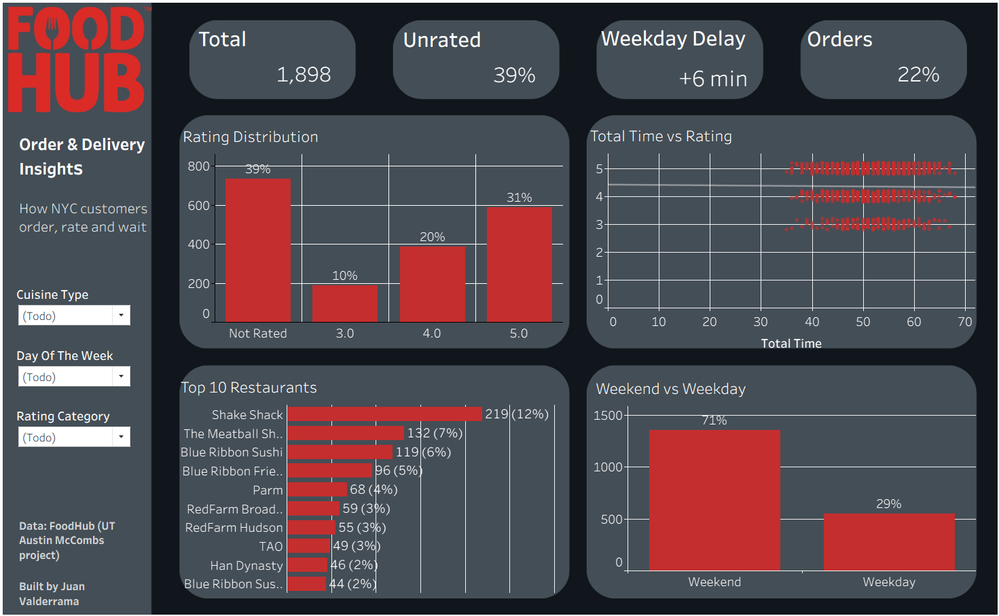

# FoodHub – Order & Delivery Insights (Tableau)

**[View the interactive dashboard on Tableau Public →](https://public.tableau.com/app/profile/juan.valderrama6223/viz/FoodhubDashboard/Foodhubdashboard)**

## Overview
Interactive dashboard built on 1,898 food delivery orders from NYC restaurants (FoodHub dataset), exploring how customers order, rate and wait.

## Key insights
- 39% of orders are never rated
- 71% of orders are placed on weekends
- Weekday orders take ~6 minutes longer on average
- Delivery time shows no clear relationship with customer ratings

## Features
- KPIs: total orders, unrated %, weekday delay, % of orders over 60 min
- Filters: cuisine type, day of the week, rating
- Charts: rating distribution, total time vs rating, top 10 restaurants, weekend vs weekday

## Tools
- Tableau (dashboard) · Canva (background design)
- Python EDA: [foodhub-data-analysis](https://github.com/juandvalderrama/foodhub-data-analysis)

## Files
- `Foodhub Dashboard (X).twbx`: packaged Tableau workbook (open with Tableau Desktop / Public)
- `dashboard.png`: dashboard preview

Built as part of the UT Austin McCombs Postgraduate Program in Data Science & Applied Generative AI.
